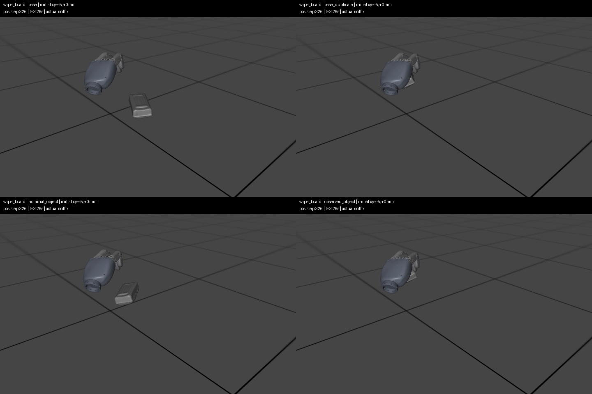

# SPIDER 复现与中途重规划

我用 SPIDER 把官方处理好的三维手物示范转成了 XHand 的控制序列，并在仿真里回放。把物体起点挪开 5 mm 后，照原动作执行有时会抓不住。执行到 1.5 秒时，我暂停仿真，读取物体位姿，用相隔 20 ms 的两帧位姿估计速度，再用 SPIDER 的求解器重算剩下的动作。

[项目演示页](https://hand-to-robot-yuzhou.scut-lang.chatgpt.site/) · [运行条件](REPRODUCE.md) · [SPIDER 官方代码](https://github.com/facebookresearch/spider)

## 仿真回放

`wipe_board`，seed 0，第 3.26 秒。左上继续原动作，右上重复原动作，左下用预计物体状态重规划，右下用仿真中读到的状态重规划。

[板状物体回放](results/native_v2_01/feedback_coverage01/wipe_board/s0/feedback_coverage_4grid.mp4) · [管状物体回放](results/native_v2_01/feedback_coverage01/pour_tube/s0/feedback_coverage_4grid.mp4)

## 两条示范的跟踪结果

| 示范 | 原动作 | 原动作副本 | 预计物体状态重规划 | 仿真物体状态重规划 |
| --- | ---: | ---: | ---: | ---: |
| `wipe_board` | 0/3 | 0/3 | 0/3 | 3/3 |
| `pour_tube` | 0/3 | 0/3 | 2/3 | 3/3 |

每条示范共用一份原控制，三次对应三个重规划搜索种子。通过的条件是末段 50 个有效参考步中，物体位置误差每步都小于 10 cm、朝向误差每步都小于 0.5 rad。两种重规划使用相同的机器人状态和搜索设置，区别在于求解器拿到的物体状态。结果衡量这两条固定开发示范的轨迹跟踪，反馈位姿直接来自仿真器。[实验协议](NATIVE_V2_FEEDBACK_COVERAGE_PROTOCOL.md) · [结果报告](V2_FEEDBACK_COVERAGE_RESULT_REPORT.md) · [结果数据](results/native_v2_01/feedback_coverage01/summary.json)

## 代码

- [重规划入口](native_spider/probe_v2_feedback_coverage.py) 包含状态读取、速度估计和使用同一执行起点的四组对照。
- [分析脚本](native_spider/analyze_v2_feedback_coverage.py) 从原始执行数组计算跟踪误差和通过次数。
- [运行条件](REPRODUCE.md) 列出固定的上游版本、所需数据和命令。重跑需要另外准备场景资产、原控制及参考轨迹。
